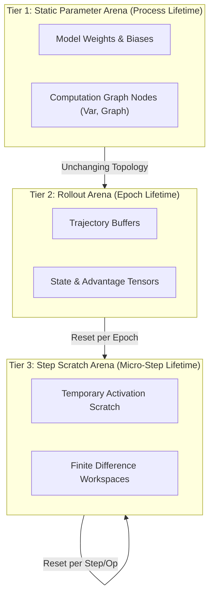

# Design Note 01: Memory Model & Arena Allocator

## 1. Overview

PyRL adopts a high-performance, deterministic memory architecture centered on **arena bump allocation** (`Arena`). Modern reinforcement learning frameworks often incur massive heap fragmentation and allocator overhead due to millions of small, variable-sized tensor allocations per training epoch. PyRL eliminates runtime heap allocations on the hot path entirely.

```
+---------------------------------------------------------------------------------+
|                               Continuous Virtual Buffer                          |
+-----------------------------------+---------------------------------------------+
| Allocated Memory (Bump Pointer)   | Unallocated Capacity                        |
+-----------------------------------+---------------------------------------------+
^                                   ^                                             ^
memory_ (Base, 64-byte aligned)     pos_ (Current Offset)                         capacity_
```

---

## 2. Allocation Architecture

### Bump Allocation Mechanics
The `Arena` manages a single contiguous virtual allocation acquired once via `std::make_unique<std::byte[]>(capacity)`. 

1. **Monotonic Pointer Bump**:
   Allocating $N$ bytes advances the byte offset `pos_`:
   $$\text{next\_pos} = \text{AlignUp}(\text{pos\_}, \text{align}) + N$$
   If $\text{next\_pos} \le \text{capacity\_}$, the pointer to the aligned offset is returned, and `pos_` is updated. This is a single arithmetic check costing **< 3 nanoseconds**.
2. **Deterministic Reset**:
   Calling `Arena::Reset()` simply sets `pos_ = 0`. All memory is instantly reclaimed without calling system `free()` or traversing linked blocks.
3. **Cache Line Alignment**:
   All allocations default to 64-byte alignment (`kDefaultAlignment`), perfectly matching modern x86-64 $L_1$ cache line sizes and enabling AVX-512 / AVX2 vector SIMD instructions without unaligned access penalties.

---

## 3. Lifetime Hierarchy

Memory in PyRL is partitioned into three distinct operational tiers:



1. **Parameter Arena**: Holds static network parameters ($W_0, b_0, W_1, b_1, W_2, b_2$) and the static computation graph nodes (`Var`). Allocated once at initialization; persists across all epochs.
2. **Rollout Arena**: Holds collected trajectories and transition buffers. Reset at the boundary of each training epoch.
3. **Step / Scratch Arena**: Used for temporary scratch buffers, topological sorting frames, and finite-difference gradient check allocations. Cleared immediately after execution.

---

## 4. Systems Invariants & Safety Guarantees

- **No Destructor Overhead**: `Arena` only allocates trivially destructible types (`static_assert(std::is_trivially_destructible_v<T>)`). Calling `Reset()` runs zero destructors, avoiding cache eviction.
- **Overflow Protection**: `Arena::PushArrayUninit` performs integer overflow checks (`count > UINT64_MAX / sizeof(T)`) prior to allocation, preventing buffer overflows.
- **Move Semantics & Isolation**: Arenas are non-copyable but moveable. Transferring ownership leaves the source in an empty, safe state via `std::exchange`.
