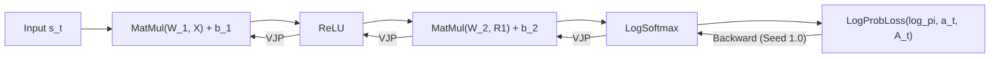

# Design Note 02: Autograd Engine Architecture

## 1. Overview

PyRL features a reverse-mode automatic differentiation engine written from scratch in modern C++20. The autograd system represents neural network computation graphs as directed acyclic graphs (DAGs) of `Var` nodes, evaluates forward passes via topological ordering, and computes exact vector-Jacobian products (VJPs) during reverse accumulation.



---

## 2. Graph Topology & Node Representation

### The `Var` Data Structure
Each node in the computation graph is an instance of `Var`:
```cpp
struct Var {
    static constexpr u32 kMaxInputs = 2;

    u32            index;              // Unique index within the parent ModelState
    VarFlags       flags;              // RequiresGrad, Parameter
    Mat*           val;                // Arena-backed matrix value
    Mat*           grad;               // Arena-backed gradient accumulator
    const VarType* type;               // Pointer to op specification (forward/backward)
    Var*           inputs[kMaxInputs]; // Predecessor nodes in the DAG
};
```

### The `VarType` Function Table
Instead of dynamic polymorphic inheritance (`virtual void Forward()`), operations are represented by constant `VarType` structures containing function pointers:
```cpp
struct VarType {
    using ShapeFn = std::optional<VarShape> (*)(const Var* a, const Var* b);
    using PassFn  = void (*)(Var& var);

    const char* name;
    u32         num_inputs;
    ShapeFn     shape;
    PassFn      forward;
    PassFn      backward;
};
```
This design gives **zero vtable lookup overhead**, compact data structures, and predictable branch targets.

---

## 3. Linear Topological Sorting ($\mathcal{O}(V + E)$)

To evaluate forward passes correctly and traverse backward passes in exact reverse dependency order, the graph must be topologically ordered: **inputs must precede their consumers**.

Earlier prototypes utilized a quadratic search with `std::erase` on a flat stack ($\mathcal{O}(V^2)$). In Phase 1, `Graph::Build` was refactored into a non-recursive, iterative **post-order depth-first search (DFS)**:

```cpp
enum class NodeState : u8 { Unvisited = 0, Visiting = 1, Visited = 2 };
```

1. **Traversal**: Starting at the graph target (`out_var`), nodes transition from `Unvisited` $\to$ `Visiting` and push explicit stack frames `{Var*, input_index}`.
2. **Post-Order Emplacement**: Once all inputs of a node are fully processed into the `order` array, the node transitions to `Visited` and is appended.
3. **Guarantees**:
   - Strictly linear time complexity $\mathcal{O}(V + E)$ where $E \le 2V$.
   - Cycle detection is built-in (`Visiting` encountering `Visiting`).
   - Constant stack memory overhead via heap-vectored frame storage.

---

## 4. Reverse Accumulation & Gradient Semantics

During `Graph::Backward()`:
1. **Gradient Initialization**:
   - The root loss gradient is seeded with $1.0$: `output->grad->Fill(1.0f)`.
   - All non-parameter intermediate node gradients are cleared (`grad->Clear()`).
   - Parameter gradients (`VarFlags::Parameter`) are **not** cleared, allowing continuous gradient accumulation across rollout transitions.
2. **Reverse Sweep**:
   - The graph is traversed from $i = \text{size} - 1$ down to $0$.
   - For each active node, `cur->type->backward(*cur)` executes, propagating vector-Jacobian products into `input->grad`.

---

## 5. Numerically Stable Operators

### LogSoftmax
Evaluating $\log(\text{Softmax}(z))$ directly via $\log\left(\frac{e^{z_i}}{\sum_j e^{z_j}}\right)$ is prone to floating-point underflow ($e^{z_i} \to 0 \implies \log(0) = -\infty$).

PyRL computes LogSoftmax via the LogSumExp trick:
$$m = \max_j z_j, \quad S = \sum_j e^{z_j - m}$$
$$\text{LogSoftmax}(z)_i = (z_i - m) - \log(S)$$

**Backward VJP**:
$$\frac{\partial \mathcal{L}}{\partial z_k} = g_k - e^{y_k} \sum_j g_j \quad \text{where } y = \text{LogSoftmax}(z)$$

### Log-Probability Gather Loss
Replaces the one-hot advantage vector hack with a true scalar policy loss:
$$\mathcal{L} = -\log \pi_\theta(a_t \mid s_t) \cdot A_t$$

**Backward VJP**:
$$\frac{\partial \mathcal{L}}{\partial (\log \pi)_k} = \begin{cases} -A_t \cdot g & \text{if } k = a_t \\ 0 & \text{otherwise} \end{cases}$$

Composed with `LogSoftmax`, the gradient w.r.t logits $z$ is:
$$\frac{\partial \mathcal{L}}{\partial z_k} = A_t \cdot \left(\pi_\theta(k \mid s_t) - \mathbf{1}_{k = a_t}\right)$$
This matches the exact policy gradient theorem without any numerical instability or division by small probabilities.
